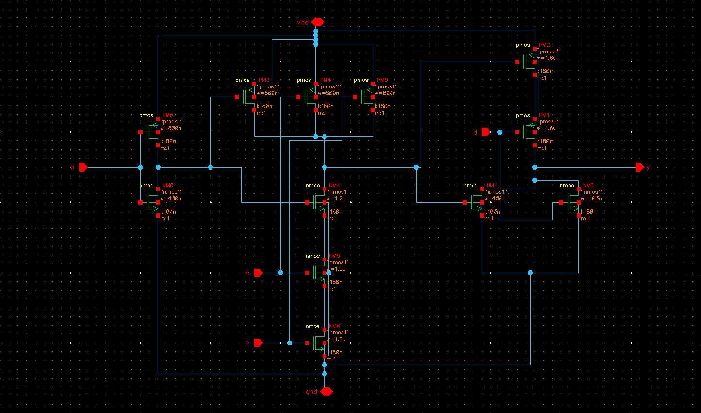
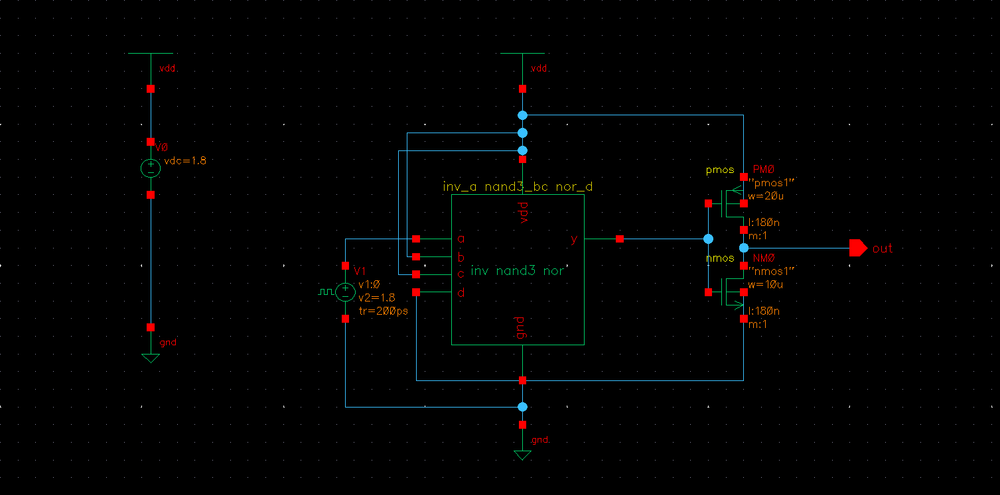
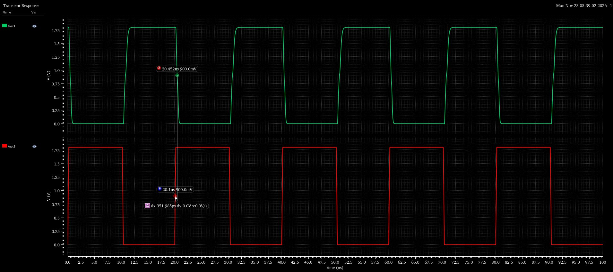
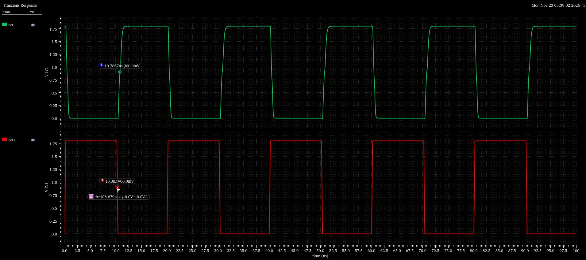
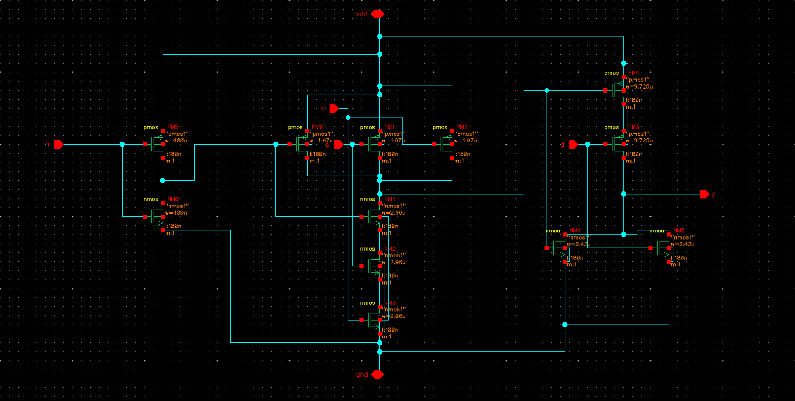
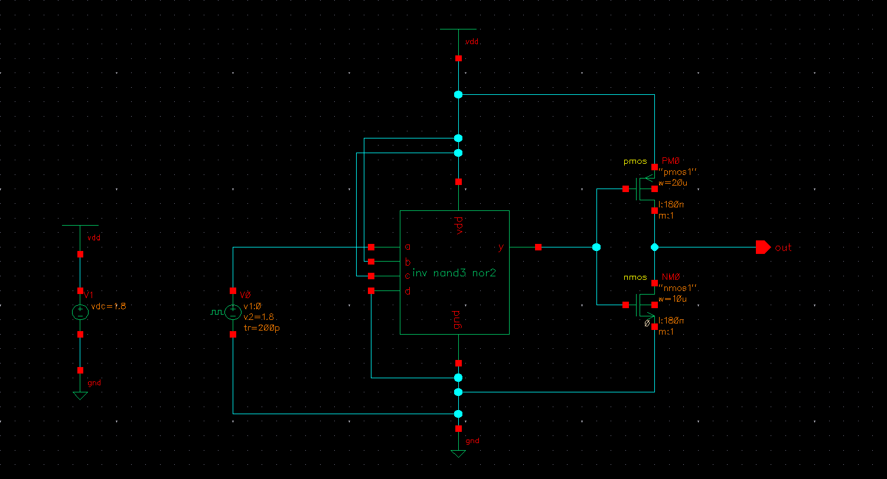
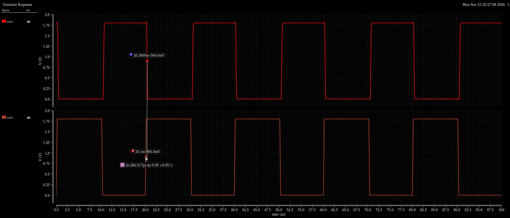

# Logical-Effort-Based CMOS Delay Optimization

**Three-stage CMOS logic path | 180 nm technology**

This repository documents a schematic-level CMOS delay-optimization project. The path under study is:

`Input → Inverter → NAND3 → NOR2 → Output`

An external inverter is connected as the output load during simulation. It is **not part of the three-stage path**.

## Project question

How can the propagation delay of a three-stage CMOS logic path (Inverter–NAND3–NOR2) be reduced using manually derived logical-effort transistor sizing, and how does the optimized schematic perform in transient simulation compared with the initial design?

## Design setup

| Parameter | Value |
|---|---:|
| Technology | 180 nm CMOS PDK |
| Supply voltage | 1.8 V |
| Channel length | 0.18 µm |
| Minimum width used | 0.4 µm |
| Input rise/fall time | 200 ps |
| Reference inverter | NMOS 0.4 µm, PMOS 0.8 µm |
| External load inverter | NMOS 10 µm, PMOS 20 µm |

The external load inverter is 25× the reference inverter in width ratio and is used in the testbench only.

## Logical-effort sizing (hand calculations)

All logical-effort and transistor-sizing calculations were performed manually. Cadence Virtuoso was used for schematic implementation and transient simulation.

The reference inverter input capacitance is approximated as proportional to:

\[
C_{inv}\propto W_n+W_p=0.4+0.8=1.2
\]

The logical efforts used are:

- Inverter: \(g_1=1\)
- NAND3: \(g_2=5/3\approx1.667\)
- NOR2: \(g_3=5/3\approx1.667\)

The total path logical effort and load effort are:

\[
G=g_1g_2g_3=\frac{25}{9}\approx2.778
\]

\[
B=1,\qquad H=25
\]

\[
F=GBH\approx69.444
\]

For three stages, the optimum stage effort is:

\[
f=F^{1/3}\approx4.108
\]

The theoretical scaling factors obtained from the hand calculations are:

- NAND3: \(X\approx2.465\)
- NOR2: \(Y\approx6.078\)

### Theoretical transistor dimensions

All widths below are per transistor in the relevant gate.

| Gate | Scaling factor | NMOS width | PMOS width |
|---|---:|---:|---:|
| Reference inverter | 1.000 | 0.40 µm | 0.80 µm |
| NAND3 | X = 2.465 | 2.958 µm | 1.972 µm |
| NOR2 | Y = 6.078 | 2.431 µm | 9.725 µm |
| External load inverter | 25× reference | 10.0 µm | 20.0 µm |

These are first-order theoretical values. Device-model capacitances, parasitics, and PDK layout rules can change the best practical sizes.

## Cadence transient simulation

The testbench uses:
- \(V_{DD}=1.8\text{ V}\)
- Input pulse from 0 V to 1.8 V
- Rise and fall times of 200 ps
- Control inputs `b` and `c` held at 1.8 V
- Control input `d` held at 0 V
- External load inverter connected to the three-stage output

Propagation delays were measured at the 50% supply level (0.9 V). The three-stage output node is used for path-delay measurement; the external load inverter's output is monitored separately.

## Results

### Baseline

| Metric | Measured result |
|---|---:|
| \(t_{pHL}\) | 486.679 ps |
| \(t_{pLH}\) | 351.985 ps |
| Average baseline delay | 419.332 ps |

\[
D_{avg,baseline}=\frac{486.679+351.985}{2}=419.332\text{ ps}
\]

### Optimized

The supplied optimized transient screenshot displays one measured transition delay:

**286.917 ps**

The second optimized transition direction was not included in the available screenshots. Therefore, 286.917 ps is reported as a single displayed transition measurement, not as an optimized average. The 31.5776% improvement calculated during the project is a preliminary figure; a rigorous average-to-average comparison requires both optimized \(t_{pHL}\) and \(t_{pLH}\) measurements.

## Cadence screenshots

### Baseline design




### Baseline delay measurements




### Optimized design






## Repository contents

```text
.
├── README.md
├── docs/
│   ├── Project_Report.pdf
│   └── Project_Report.docx
├── images/
│   ├── baseline_schematic.png
│   ├── baseline_testbench.png
│   ├── baseline_tpHL.jpg
│   ├── baseline_tpLH.jpg
│   ├── optimized_schematic.png
│   ├── optimized_testbench.png
│   └── optimized_transient_delay.png
└── calculations/
    └── logical_effort_calculations.md
```

## Work completed

- Three-stage schematic design
- Baseline transient simulation
- Manual logical-effort and transistor-sizing calculations
- Optimized schematic implementation
- Optimized pre-layout transient simulation

## Work remaining

- Physical layout
- DRC and LVS verification
- Parasitic extraction
- Post-layout transient simulation and delay comparison

No layout, DRC/LVS, extraction, or post-layout result is claimed in this repository.

## Tools

- Cadence Virtuoso
- 180 nm CMOS PDK
- Logical-effort hand calculations
- Transient analysis

## Note on reproduction

The repository contains the project report and the Cadence screenshots supplied for this work. The Cadence schematics are screenshots, not editable Virtuoso library or cellview databases. The PDK model files are not included.
